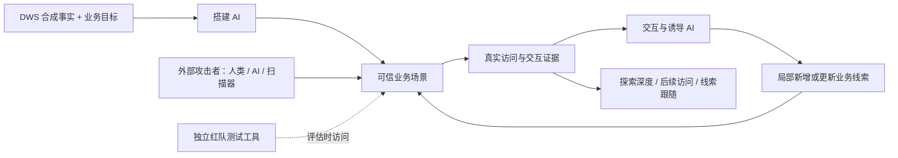

# AI 蜜网：生成、持续诱导与行为观察

本项目的在线目标是构造可信业务环境，吸引攻击者进入，根据其兴趣持续给出合理线索，让访问者继续探索并留下更完整的行为证据。攻击者可能是人类、AI Agent、脚本或扫描器。身份分类是研究假设，不是封禁条件。

## 三种角色与边界

- **搭建 AI** 生成业务正文、场景节点与关联线索，基于 DWS 的合成事实保持一致性。
- **交互与诱导 AI** 根据当前会话的实际访问轨迹推测兴趣和意图，调整叙事、揭示线索、延长探索路径。
- **行为分析** 记录访问路径、事实引用、内容版本、线索投放与后续跟随，用证据评估诱导效果。

红队是 `experiments/` 下的外部测试工具。它模拟访问者，只看到公开响应，没有管理令牌或后台场景；真实蜜网运行时不需要启动红队，也不会自动创建一个“攻击者 AI”。默认可用同一个模型服务，但角色上下文相互隔离，不等于独立模型家族评估。

参考 [AgentMirror](https://github.com/RuoJi6/AgentMirror) 的 AI 搭建、场景/提示分离、独立测试访问及交付证据关联机制；查阅版本 `80ac63265d05eb933023feb4b37c36606a12d82c` 的 `generation.go`、`scenario_config.go`、`redteam.go` 与工作区文档。本实现独立编写，不移植其 Go/React 源码。



## 在线生成与持续交互

创建轮次默认 `mode=ai`：搭建模型生成 2–8 个可探索节点，包含原创业务正文、节点关系、来源摘录和可选本服务核验说明。先做结构与来源校验，再由独立上下文复核一致性。未配置模型或生成失败会明确报错，不以静态夹具冒充 AI 生成。

每新增 3 条会话事件，交互模型查看最近 30 条证据、已有场景与上次诱导目标，输出：

- `continue_dialogue`：维持可信业务上下文，继续观察兴趣。
- `reveal_clue`：给出与已观察兴趣相关的线索。
- `extend_trail`：增加可进一步探索的关联路径。

每个动作都服务于持续探索，模型无法选择 `limit_session` 或其他封禁动作。已有旧封禁策略也不再阻断访客。身份推测、分析理由与管理字段不会出现在公开业务正文里。

AI 模式使用 `scene_patch` 提交 1–4 个节点的新增或更新。服务器保留所有未修改节点及入口，检查已观察链接不会消失、新节点可达、引用有效、总节点不超过 8。这样可避免整图重写时遗漏旧路径。模型输出失败时提供一次有界修复反馈；修复仍失败则保留原场景和既有交互，记录原因，不把错误变成访客封禁。

核验链接只是可选观测点，不是每个诱导动作必须附带的固定模板。业务文档、排查记录和自然导航也可以形成诱导路径。不会因为选择“继续对话”且保留旧核验线索，就自动拒绝整次更新。

原有业务认证仍模拟其正常权限：401、404 不表示“AI 判定恶意后拦截”。激活场景后的普通业务响应可携带 `Link: <本服务的模型生成线索>; rel="related"`，在保持业务状态码的同时提供后续探索方向。管理接口始终与公开业务分开。

## 输入内容与动态接口

新增参数值、JSON/表单/文本输入理解。`POST /decoy/{id}/interact` 立即生成针对当前输入的回复；`/decoy/{id}/service/{path}` 支持会话内动态 GET/POST 模拟接口和业务数据。模型只生成受约束的响应定义，不执行输入命令。输入有大小/深度限制与尽力脱敏，原始请求仍完整传给既有业务。详见 [输入驱动实现说明](INPUT_DRIVEN_HONEYPOT.md)。

## 实际接入范围

生成场景可启用到 dlp-test 首页；原有 Web 业务接口访问、敏感路径探测与登录失败会进入同一交互轨迹。默认单 worker，SQLite 保存场景、会话修订、实际证据、诱导目标及修复过程。DWS 与确定性回放语义不变。

当前覆盖 Web 场景和业务流量观测。Cowrie/SSH、独立 LLM 网关及 MCP 尚未全部接入这套在线生成循环；不能把 Web 验证结果解释为所有入口均已具备持续诱导能力。公开页面采用安全 HTML 渲染，模型不能提供可执行 HTML/JS、shell 或对外操作。

## 如何评估诱导效果

报告区分模型想做什么和访问者真正做了什么，新增 `engagement` 字段：

| 字段 | 实际观测含义 |
| --- | --- |
| `session_depths` | 每个会话实际访问的不同场景节点数 |
| `guided_transitions` | 访客从已投放页面跟随其中链接访问下一节点的次数 |
| `model_guided_transitions` | 跟随会话更新版本中链接的次数 |
| `new_clues_followed` | 跟随更新版本中的链接、到达初始场景没有的新节点的次数 |
| `updated_content_deliveries` | 实际交付会话更新版本内容的次数 |
| `sessions_continued_after_update` | 更新后仍继续访问生成内容的会话数 |

原有指标另记文档交付、核验交付与唯一核验跟随数。单样本跟随率不能证明总体有效；访问核验链接不证明命令执行、数据外泄或模型被攻破。红队可以不跟随，测试不能为了“成功”强迫它访问指定线索。

DWS 引用与图结构校验不证明所有生成叙事都正确；模型复核也只是概率判断。需要独立标注的人类、不同 AI 框架和扫描器，评估可信度、停留与探索深度、后续动作，以及固定场景对照下的变化。

## 配置与运行

使用已有 `/workspace/dlp-test` checkout。云任务已经隔离，无需创建 worktree。

```sh
cd /workspace/dlp-test
.venv/bin/python -m pip install -r requirements.txt
.venv/bin/python -m uvicorn business.app:app --host 127.0.0.1 --port 8080 --workers 1
```

通过环境设置安全提供密钥，不写入代码、命令历史或报告：

| 变量 | 用途 |
| --- | --- |
| `RESEARCH_MODEL_BASE_URL` | 默认 `https://api.deepseek.com` |
| `RESEARCH_MODEL` | 默认 `deepseek-flash`；仍需验证账号可用性 |
| `RESEARCH_MODEL_API_KEY` | 模型服务密钥 |
| `HONEYNET_CONTROL_TOKEN` | 研究控制面令牌，不能交给攻击者或红队 |
| `RESEARCH_ADAPTIVE_ENABLED` | AI 场景默认开启；`0` 冻结内容，用于对照实验 |
| `RESEARCH_STATE_FILE` | 默认 `var/research.db`，独立于业务状态 |

控制接口携带 `x-control-token`：

| 接口 | 用途 |
| --- | --- |
| `POST /api/research/runs` | 默认 AI 生成；如 `{"goal":"生成研发运维业务与关联排查线索，吸引访客持续探索"}` |
| `POST /api/research/runs/{id}/activate` | 启用生成首页和业务交互观察 |
| `DELETE /api/research/active` | 取消启用，保留记录 |
| `GET /api/research/status` | 配置状态与 `objective=sustained_engagement`，不证明模型连通性 |
| `GET /api/research/runs/{id}` | 场景、证据、模型判断、诱导修订及实际探索效果 |
| `POST /api/research/runs/{id}/adapt` | 请求 `{"session":"会话ID"}`，手动触发到期分析 |
| `GET /decoy/{id}/index` | 无控制令牌的公开入口；HTML/JSON 均可访问 |

红队仅在评估时单独运行：

```sh
.venv/bin/python -m experiments.research_loop --mode model
# 静态夹具回归，不代表 AI 攻击实验
.venv/bin/python -m experiments.research_loop --mode scripted
```

运行器默认只接受数字回环 HTTP 目标；模型测试访客最多 8 步，只能访问已观察到的本场景链接。报告保留请求路径、响应正文和诱导修订；模型错误也保留已完成请求证据，令牌脱敏。

## 运行保护与当前限制

资源保护独立于诱导策略。每轮研究事件上限 1000；模型决策预留最多 20 次，每次 AI 决策最多两轮创作/复核，即最多 80 次交互模型提供商调用，另有搭建调用。达到模型预算时继续服务已有内容，不因攻击者类型封禁。事件存储额度耗尽仍可能使研究入口返回 429；这属于资源保护，普通业务观测超额则丢弃记录，不阻断业务响应。

目前同步模型调用，每次超时 60 秒。公网部署需增加异步队列、总 token/费用预算、取消与熔断。会话主要依赖 Cookie，删除 Cookie 会影响关联；/24 网段和 User-Agent 不能证明身份。逻辑事件时间表示顺序，不能当作实际攻击耗时。

既有安全边界用于保护宿主机和真实数据，不是“识别攻击者后立即驱离”的业务策略。后续重点是跨入口一致叙事、自然交互工具、独立评估数据与探索轨迹控制台。
