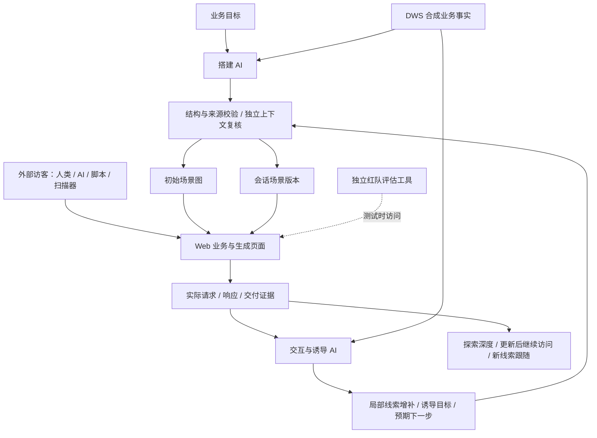

# 当前项目实现方案、模块与原理

## 1. 项目目标与实现状态

项目目标是一个**吸引攻击者进入、保持可信交互、持续提供探索线索并记录行为的 AI 蜜网**。访客可能是人类、AI Agent、脚本或扫描器。在线模型根据已观察到的兴趣调整业务叙事；身份推测用于研究分析，不作为驱离访客的条件。

当前实现由既有 DWS 业务/回放内核和新增 AI Web 交互层组成。AI Web 层已接通真实 DeepSeek，能够生成场景、处理真实访问证据、局部更新会话内容。SSH、独立 LLM 网关等入口已有基础实现，但尚未全部接入同一在线诱导循环。

红队只存在于独立实验运行器中，用来评估蜜网；普通运行不需要启动红队，也不会自动派一个 AI 去攻击其他系统。

## 2. 总体架构



技术栈：Python、FastAPI、Pydantic、HTTPX；SQLite 保存 AI 研究状态；业务状态采用 JSON 原子检查点。Postgres、Redis、Cowrie 属于既有可选部署组件，默认本地 Web 工作流不依赖这些服务。

## 3. 模块与职责

| 模块 | 关键实现 | 职责与状态 |
| --- | --- | --- |
| 契约层 | [`contracts/`](../contracts/) | 统一事件 schema、业务对象 schema、原有规则和特性说明；约束结构，不充当 AI 内容生成器 |
| DWS 事实与状态 | [`dws/world.py`](../dws/world.py)、[`facts.py`](../dws/facts.py)、[`hlc.py`](../dws/hlc.py)、[`invariants.py`](../dws/invariants.py) | 保存实体与事实版本、逻辑时钟、会话视图、提交冲突和不变量；提供一致的合成世界 |
| 确定性回放 | [`replay/engine.py`](../replay/engine.py)、[`harness.py`](../replay/harness.py)、[`acceptance.py`](../replay/acceptance.py) | 将既定事件作用到世界；重复回放比较输出；随机轨迹检验不变量。回放内不调用外部模型 |
| 业务平台 | [`business/app.py`](../business/app.py)、[`enterprise.py`](../business/enterprise.py)、[`storage.py`](../business/storage.py) | 登录、工单、应用、资产、变更、数据库投影、知识文档与审计；从 DWS 读写，保存原子检查点 |
| 模型通信 | [`research/model.py`](../research/model.py) | HTTPS OpenAI 兼容 JSON 调用；默认 DeepSeek；限制输出、检测空/截断正文，不记录密钥或思考内容 |
| AI 搭建与校验 | [`research/generation.py`](../research/generation.py) | 生成原创场景图；精确来源摘录检查、可达性检查、节点约束和独立上下文复核 |
| 在线交互与诱导 | [`research/controller.py`](../research/controller.py) | 根据轨迹推测意图，生成局部线索补丁；保留旧链接；有界修复；原子应用会话版本；没有模型封禁动作 |
| 场景与证据存储 | [`research/lab.py`](../research/lab.py) | SQLite 保存轮次、事件、交付、会话策略和模型决策；服务生成节点；关联核验访问；计算探索指标 |
| 业务观测 | [`research/observer.py`](../research/observer.py) | 观察激活场景下的真实 Web 请求、探测、登录失败和状态；关联会话；触发诱导；提供相关线索 Link 头 |
| 控制面与公开面 | [`research/api.py`](../research/api.py)、[`render.py`](../research/render.py) | 令牌保护创建/启用/分析；公开场景无控制令牌访问；安全 HTML 或 JSON 输出 |
| 画像与报告 | [`research/analysis.py`](../research/analysis.py)、[`reporting.py`](../research/reporting.py) | 规则提示与模型判断分开；报告记录真实请求路径、响应、版本、意图、修复与跟随结果；令牌脱敏 |
| 既有采集入口 | [`entries/cowrie/bridge.py`](../entries/cowrie/bridge.py)、[`entries/gateway/app.py`](../entries/gateway/app.py) | Cowrie 日志转统一事件；OpenAI 兼容蜜网入口。存在基础实现，完整在线生成接入仍待完成 |
| 既有身份与分析 | [`identity/`](../identity/)、[`analysis/`](../analysis/)、[`scorer/`](../scorer/) | 确定性身份候选关联、行为规则、CSVR 和一致性证据评估；网段/凭据关联不证明真实身份 |
| 合成业务客户端 | [`agent_runtime/`](../agent_runtime/) | 六种合成员工角色通过同一业务 API 跑七步工作流；用于业务一致性验证，区别于外部红队 |
| 独立实验工具 | [`experiments/research_loop.py`](../experiments/research_loop.py) | 默认真实模型评估；独立上下文只看公开响应；脚本夹具显式启用。不是蜜网在线组件 |
| 测试与部署 | [`tests/`](../tests/)、[`deploy/`](../deploy/) | 单元、契约、回放、业务、生成与交互测试；可选 Docker 编排，不代表已完成公网部署验收 |

## 4. 核心实现原理

### 4.1 AI 创作与确定性事实分工

DWS 负责世界中已经成立的合成事实，包括主机、身份、凭据、文档、关系及业务对象。业务接口与回放读取相同事实，避免不同入口出现相互矛盾的内容。

AI 负责创作业务叙事、组织线索和选择下一步交互。生成结果引用 DWS 文档的 `fact_id`，并附真实存在的原文摘录。图结构检查、引用检查和模型复核通过后才服务给访客。准确摘录只能证明引用真实存在，不能证明所有生成语义必然正确。

在线 AI 场景与每次修订作为研究状态保存，不把随机模型输出写入确定性回放内核；因此既有回放仍可逐字节复验。

### 4.2 初始场景生成

1. 管理者给出业务目标，控制面读取当前 DWS 知识文档快照。
2. 搭建模型生成 2–8 个节点，包含正文、链接、来源和可选核验引导。
3. 程序检查节点 ID、来源摘录、链接可达性和允许的内容能力。
4. 独立模型上下文复核事实一致性，区分阻断问题 `issues` 与非阻断备注 `notes`。
5. 创建轮次并保存初始场景；管理者可将其启用到首页和 Web 观测。

模型不可用或生成失败时明确报错，不用固定模板冒充 AI 结果。显式 `fixture` 模式仅供离线回归与对照。

### 4.3 行为驱动的持续诱导

每新增 3 条会话事件，交互模型查看最近 30 条证据、当前会话场景和上次目标，提出：

- `continue_dialogue`：继续可信业务上下文。
- `reveal_clue`：揭示与当前兴趣相关的线索。
- `extend_trail`：增加下一步可探索的关联路径。

模型同时输出意图与不确定性、依据事件 ID、诱导目标 `engagement_goal`、预期下一节点和 `scene_patch`。局部补丁只新增或更新选定节点，服务器保留未修改节点、入口和旧链接，避免上一轮访问路径被抹掉。

无效输出最多获得一次修复反馈。修复后仍不成立，就继续服务原有场景并记录原因。推理在数据库事务外进行；决策先预留，写入时检查版本，防止重复推理和旧结果覆盖新版本。

普通业务仍保留其自然认证语义。401/404 表示业务权限或路径结果；在线模型不会因认定访客是攻击者而封禁。生成线索也可通过标准 `Link: <本服务路径>; rel="related"` 提供。

### 4.4 交付、跟随与版本证据

生成页面响应会记录节点、来源事实、当时的会话修订版本及所提供链接。核验标识由服务端随机生成，绑定轮次、会话和真实交付，报告仅保留脱敏关联。其他会话重放核验链接不会被视为原访客的有效跟随。

报告区分“模型建议了一条线索”“内容已交付”和“访问者真的访问了下一步”。重复访问同一核验不会增加成功交付数。业务观测、内容交付和核验请求统一使用事件结构，但研究事件不直接送入只支持既定事件类型的旧回放引擎。

### 4.5 效果评估

`engagement` 指标包括每会话不同节点数、已投放链接的实际路径转移、更新版本链接的转移、新节点跟随、更新内容交付，以及更新后继续访问的会话数。

这些是行为观测，不能直接解释为人类/AI 身份识别准确率、攻击者被控制或命令执行成功。核验访问只证明访问了本服务链接。红队可以不跟随，不会为了得到成功率强迫它走指定路径。

## 5. 数据和状态分层

| 数据 | 保存位置 | 特征 |
| --- | --- | --- |
| 契约与初始合成世界 | `contracts/`、`tests/fixtures/` | 版本化代码资产，无真实生产凭据 |
| 业务检查点 | 默认 `var/business-state.json` | 原子替换，保存 DWS 全事实版本、审计与采集事件 |
| AI 研究状态 | 默认 `var/research.db` | SQLite；`runs`、`events`、`exposures`、`policies`、`decisions`、`settings` |
| 模型密钥与控制令牌 | 安全注入环境变量 | 不进入代码、报告或 Git |
| 本地测试证据 | `artifacts/` | JSON/Markdown，Git 忽略；共享摘要需脱敏后独立整理 |

业务会话令牌不随重启恢复；AI 会话策略持久化。当前实现按单 worker 运行，不具备多实例共享业务事务能力。

## 6. 启动与管理流程

安装并启动：

```sh
python3 -m venv .venv
.venv/bin/python -m pip install -r requirements.txt
.venv/bin/python -m uvicorn business.app:app --host 127.0.0.1 --port 8080 --workers 1
```

配置 `RESEARCH_MODEL_BASE_URL`、`RESEARCH_MODEL`、`RESEARCH_MODEL_API_KEY` 与 `HONEYNET_CONTROL_TOKEN`。默认模型地址为 `https://api.deepseek.com`、模型名 `deepseek-flash`；密钥由环境安全提供。详细参数见 [持续诱导方案](ADAPTIVE_RESEARCH.md)。

使用控制令牌调用 `POST /api/research/runs` 创建 AI 场景，再调用 `POST /api/research/runs/{id}/activate` 启用。外部访客从首页或 `/decoy/{id}/index` 进入，无需控制令牌。`GET /api/research/runs/{id}` 获取研究记录；`DELETE /api/research/active` 取消启用并保留数据。

默认本地工作流无需启动红队、Docker、Postgres 或 Redis。部署已有 SSH/独立网关组件时另按 `deploy/` 和入口说明配置。

## 7. 当前验证结果

截至本轮代码交付：354 项测试通过；两次确定性回放一致；200 条轨迹、3123 个事件的不变量与确定性快速验收通过。

真实 DeepSeek 持续诱导回归使用隔离本地实例，最终轮包含 12 次 HTTP 请求和 13 次模型调用：搭建 1、交互 3、复核 4、独立测试红队 5。三次 `extend_trail` 更新全部应用。

实际结果：更新内容交付 1 次，独立模型访客探索 3 个不同节点，核验跟随 1 次；**更新版本的链接跟随和新增节点跟随均为 0**。更新内容交付发生在本助手驱动的探测序列中。证明了在线更新可应用，但尚未证明新增诱饵足够吸引自主攻击模型，不能将此结果描述为完整持续诱导效果已验收。

本地原始证据保存在被 Git 忽略的 `artifacts/research/engagement-live/`。本说明只上传脱敏汇总，不上传运行数据库、令牌或本地原始日志。

## 8. 当前边界与后续工作

- Web 在线生成已实现，完整 SSH/LLM/MCP 联动尚待接入。
- 合成文档场景和业务平台可用，尚非任意协议服务、操作系统或真实漏洞执行环境。
- 同步模型调用，需补充异步队列、取消、延迟和总费用控制。
- 每轮模型决策和存储有资源额度；预算保护独立于诱导策略，不是按身份驱离。
- 关联主要依赖 Cookie 和有限结构特征；不能声称已可靠区分人类、AI 和扫描器。
- 需独立标注数据、不同模型/真人/扫描器与固定场景对照，验证可信度、探索深度和新线索吸引力。
- 需进一步提供场景编辑、轨迹可视化及运营界面；目前主要通过 API 和报告操作。
