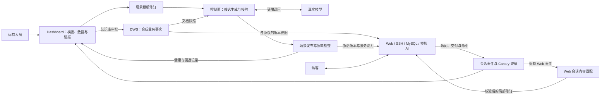

# AI 蜜网项目介绍

AI 蜜网为安全团队搭建一套可交互的模拟企业环境。访客可以浏览模拟 OA、连接 SSH、查询 MySQL，或调用模拟 AI API。四个入口使用合成的企业资料，安全人员可以在 Dashboard 上查看实际访问产生的记录，追查诱饵从哪里发出、后来在哪个入口被使用，并管理下一批访客会看到的内容。

## 项目能帮助安全团队做什么

- **搭建可交互的模拟企业环境。** 用合成的员工、主机、知识库和服务组成一套相互关联的业务环境。安全团队可以从多个入口观察访客如何探索这些内容。
- **追踪诱饵的流转。** Web 向访客交付 Canary，也就是一个可追踪的诱饵标记。同一会话重复读取时标记稳定，不同会话收到不同标记。支持的入口识别到标记时记录命中，即使对应的认证被拒绝。运营人员可以据此追查标记从哪个会话交付、又在哪个服务出现。归因到个人仍需结合其他证据。
- **维护和更新模拟业务。** 管理人员可以在 Dashboard 新增或修订场景模板，编辑和审批合成知识库文档，查看发布记录和运行数据。控制面可基于指定模板修订创建场景，系统校验后再发布。

## 系统由哪些模块组成

| 模块 | 接收什么 | 处理后交给谁 |
| --- | --- | --- |
| 合成业务与 DWS | 初始数据、经过审批的知识库变更、已有世界状态 | 维护主机、身份、应用、资产和文档等合成事实，导出版本化视图供访客入口读取，也把当前知识文档提供给场景生成。业务层在这些事实之上提供 OA 页面、工单等模拟业务。 |
| 协议入口 | 访客请求、各协议的认证信息、绑定的版本 | 为 Web、SSH、MySQL 和模拟 AI 提供可交互的响应，并产生访问、认证或诱饵使用等观测记录。 |
| AI 场景生成 | 业务主题、模板修订、DWS 知识文档 | 创建带正文、链接和事实引用的候选场景，交给校验和发布模块。 |
| Web 在线适配 | 近期会话事件、当前场景和可用线索 | 为当前 Web 会话提出新的链接、回复或局部内容。校验通过后写入会话修订，已有链接仍可访问。 |
| 场景发布与运行管理 | 通过校验的候选内容、服务能力声明及审批 | 准备并探测所需服务，保存发布清单，切换新会话使用的场景。运行期间记录依赖健康和已支持的回退结果。 |
| 事件与 Canary | 入口观测、服务发送的诱饵、后续核验和认证尝试 | 持久化实际交付及使用记录，将匹配的跨入口证据交给 Dashboard。Cowrie 日志通过桥接转换为统一事件。 |
| Dashboard | 会话证据、发布记录、状态探测、延迟采样、预算账本 | 向运营人员提供查询和运行状态；将模板修订及合成知识库草稿送入各自的管理流程。 |
| 回放与评估 | 既定事件序列、测试轨迹和研究观测 | 检查世界状态是否遵守一致性规则，复验相同输入能否得到相同输出，并统计访客后续探索行为。 |

DWS 是合成业务事实的来源。研究数据库保存场景、会话修订、观测和诱饵证据。场景可以引用事实，例如某篇合成文档中的原文；是否发布、哪个会话已经看到、某条线索是否被跟随，则由研究记录追踪。[模块实现](CURRENT_IMPLEMENTATION.md)

## 模块怎么串起来

**访客交互链路。** 以模拟研发平台的知识文档为例，访客打开 OA 首页时先看到预置 OA，Web 在后台绑定已发布场景。访客沿知识库导航浏览，有通过校验的会话线索时，知识库会显示「相关资料」。从该版本返回的文档带有会话专属诱饵。系统记录发送事实；如果后来有人在 Cowrie、MySQL 或模拟 AI 中提交可匹配的诱饵，系统记录入口及关联结果。运营人员可以据此看到同一个诱饵由哪里交付、在哪里出现过。登录成功、诱饵命中和现实身份归属是不同的判断。

**Web 适配链路。** 如果访客持续查看一类内容，Web 观测模块会积累会话事件。已有在线适配可以根据近期活动提出相关文档或后续线索，检查来源引用和可访问路径，再更新当前会话的局部内容。失败时继续沿用原有内容并记录结果。系统分别记录模型提出线索、服务实际提供线索、访客后续访问三个阶段。该行为驱动的在线联动目前在 Web 实现。[在线交互原理](CURRENT_IMPLEMENTATION.md#43-行为驱动的持续诱导)

**发布管理链路。** 模板定义拟构建的业务场景，DWS 提供可引用的既有资料，控制面依据两者生成候选。发布模块检查结构、资料引用及服务依赖，生成可激活的场景；访客入口按发布和会话绑定读取内容。依赖健康结果及回退操作写入发布记录，运营人员可从管理端复查。

## 四个入口各自提供什么

| 入口 | 访客能做什么 | 系统如何形成响应 |
| --- | --- | --- |
| Web / OA | 浏览模拟业务页面和知识库文档，打开服务投放的诱饵链接。 | Web 为访客固定场景版本，从该场景读取文档和路由。 |
| Cowrie SSH | 使用合成账号连接交互式终端，查看模拟主机名和文件，在沙箱内操作。 | Cowrie 建立会话时读取对应版本的只读导出，终端内写入由会话沙箱处理。 |
| MySQL | 用真实 MySQL 客户端认证，并运行连通性和目录查询。 | 轻量入口从对应版本生成只读目录。需要完整 SQL 能力的场景可使用经审批的隔离 MySQL 实例。 |
| 模拟 AI API | 查询模型清单，或提交聊天请求体验模拟服务。 | 模型清单和聊天使用绑定的模拟数据视图。已认证会话由凭据和客户端标签限定。 |

共享数据由 DWS（模拟环境状态库）维护，内容包括合成主机、身份、服务和业务数据。各入口按协议读取适合自己的数据视图。带有效期的版本票据让四个入口可显式选择同一历史版本。各协议仍独立执行认证。票据管的是数据版本，Canary 命中记录的是已交付诱饵在哪里被使用。[架构说明](ARCHITECTURE_V2.md)

## 场景如何生成、校验、发布与恢复

1. **创建。** 操作员选择模板修订，由控制面生成候选场景。启用真实模型时，控制面发送经过筛选的输入，并限制调用预算、并发和超时。访客看到的模拟 AI API 由访客入口提供。
2. **检查。** 系统检查候选结构、引用服务和运行依赖。需要独立 MySQL 或 Nginx HTTP 实例的场景经显式审批后准备运行时，并通过真实就绪检查。
3. **发布。** 通过检查后激活场景，新进入的访客使用新版本。已绑定的会话继续读取原发布版本，同一会话内经校验的内容修订仍可单独演进。
4. **恢复。** 准备失败时保留当前发布。发布后，后台持续检查已支持的 HTTP 和 MySQL 依赖。出现已覆盖的故障时，系统可停止给新访客投放故障版本，或回退至先前可用版本。运营人员也可以查看发布记录并手动回滚。
